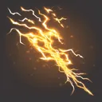

# { .gi .gi-title width="64" height="64" loading="lazy" } Charged Bolt

**Where to play:** Discord
{ .where-to-play }

- **Class:** { .gi .gi-mention width="20" height="20" loading="lazy" }&nbsp;[Wizard](../../../classes/wizard.md)
- **Tree:** { .gi .gi-mention width="20" height="20" loading="lazy" }&nbsp;[Lightning Spells](index.md)
- **Kind:** an area attack, a spell
- **Learn it from:** level 1 (your rank)
- **Needs first:** no other skill
- **Opens:** { .gi .gi-mention width="20" height="20" loading="lazy" }&nbsp;[Lightning](lightning.md)
- **Weapon:** any
- **Mana:** 2 at rank 1, 21 at rank 20

> In the game: Fires bolts of electricity that seek their targets.

## How it works

- It hits every monster.
- Its lightning damage never misses: only physical attacks roll to hit.
- It costs its mana once, when used. Without enough mana, or without the weapon or shape it needs, its button says **Attack** and makes the regular attack instead, for free.

## Checked in play

- Every monster takes its lightning damage: 1-12 at rank 1, 1-240 at rank 20.

## Rank by rank

What its skill screen shows at each rank. The battle uses exactly these numbers (checked at ranks 1 and 20). A skill takes at most 20 points; 💥&nbsp;[skill points and resets](../../index.md).

| Rank | Lightning damage | Mana |
|---|---|---|
| 1 | 1-12 | 2 |
| 2 | 1-24 | 3 |
| 3 | 1-36 | 4 |
| 4 | 1-48 | 5 |
| 5 | 1-60 | 6 |
| 6 | 1-72 | 7 |
| 7 | 1-84 | 8 |
| 8 | 1-96 | 9 |
| 9 | 1-108 | 10 |
| 10 | 1-120 | 11 |
| 11 | 1-132 | 12 |
| 12 | 1-144 | 13 |
| 13 | 1-156 | 14 |
| 14 | 1-168 | 15 |
| 15 | 1-180 | 16 |
| 16 | 1-192 | 17 |
| 17 | 1-204 | 18 |
| 18 | 1-216 | 19 |
| 19 | 1-228 | 20 |
| 20 | 1-240 | 21 |
