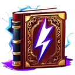
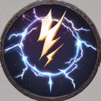

# { .gi .gi-title width="64" height="64" loading="lazy" } Thunder Storm

**Where to play:** Discord
{ .where-to-play }

- **Class:** { .gi .gi-mention width="20" height="20" loading="lazy" }&nbsp;[Wizard](../../../classes/wizard.md)
- **Tree:** { .gi .gi-mention width="20" height="20" loading="lazy" }&nbsp;[Lightning Spells](index.md)
- **Kind:** a buff, a spell
- **Learn it from:** level 24 (your rank)
- **Needs first:** { .gi .gi-mention width="20" height="20" loading="lazy" }&nbsp;[Nova](nova.md), { .gi .gi-mention width="20" height="20" loading="lazy" }&nbsp;[Chain Lightning](chain-lightning.md)
- **Opens:** no other skill
- **Weapon:** any
- **Mana:** 2 at rank 1, 21 at rank 20

> In the game: Summons a thunderstorm that periodically blasts a nearby enemy with a bolt of lightning.

## How it works

- It's on you for its rounds.
- A monster it stuns skips its attack that round.
- It costs its mana once, when used. Without enough mana, or without the weapon or shape it needs, its button says **Attack** and makes the regular attack instead, for free.

## Checked in play

- For its rounds (15 at rank 1, 72 at rank 20), every round has its proc chance (35%, 92%) to strike a monster with its lightning (1-30, 1-505) and its stun chance (3%, 18%); a critical strike deals +75%. A monster's damage shield takes its share first, and the storm keeps striking.

## Rank by rank

What its skill screen shows at each rank. The battle uses exactly these numbers (checked at ranks 1 and 20). A skill takes at most 20 points; [skill points and resets](../../index.md).

| Rank | Lightning damage | Stun chance (%) | Strike chance (%) | Rounds | Mana |
|---|---|---|---|---|---|
| 1 | 1-30 | 3 | 35 | 15 | 2 |
| 2 | 1-55 | 4 | 38 | 18 | 3 |
| 3 | 1-80 | 5 | 41 | 21 | 4 |
| 4 | 1-105 | 5 | 44 | 24 | 5 |
| 5 | 1-130 | 6 | 47 | 27 | 6 |
| 6 | 1-155 | 7 | 50 | 30 | 7 |
| 7 | 1-180 | 8 | 53 | 33 | 8 |
| 8 | 1-205 | 9 | 56 | 36 | 9 |
| 9 | 1-230 | 9 | 59 | 39 | 10 |
| 10 | 1-255 | 10 | 62 | 42 | 11 |
| 11 | 1-280 | 11 | 65 | 45 | 12 |
| 12 | 1-305 | 12 | 68 | 48 | 13 |
| 13 | 1-330 | 13 | 71 | 51 | 14 |
| 14 | 1-355 | 13 | 74 | 54 | 15 |
| 15 | 1-380 | 14 | 77 | 57 | 16 |
| 16 | 1-405 | 15 | 80 | 60 | 17 |
| 17 | 1-430 | 16 | 83 | 63 | 18 |
| 18 | 1-455 | 17 | 86 | 66 | 19 |
| 19 | 1-480 | 17 | 89 | 69 | 20 |
| 20 | 1-505 | 18 | 92 | 72 | 21 |
