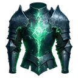

# { .gi .gi-title width="64" height="64" loading="lazy" } Assault Fortification

**Where to play:** Discord
{ .where-to-play }

- **Kind:** earned in heists
- **Each charge:** +100% Block Chance
- **Used:** when you defend: the next hit is blocked; one earned on an attack is kept for later, it doesn't block that same heist's counter-attack

## Where you get it

The [Gain Assault Fortification (100% Block Buff) attack](../attacks-and-defence/gain-assault-fortification.md) and the gear { .gi .gi-mention width="20" height="20" loading="lazy" }&nbsp;[Einherjar's Rejuvenating Cuirass](../gear/einherjars-rejuvenating-cuirass.md), { .gi .gi-mention width="20" height="20" loading="lazy" }&nbsp;[Einherjar's Wrathful Loop](../gear/einherjars-wrathful-loop.md) give a chance to earn one charge each heist; pets can too.

## Checked in play

- Won on an attack, it's yours after the heist: it can't block that heist's own counter-attack. It blocks the next hit; as the raider, the next counter-attack.
- The heist menu lists it with its charges and its number and adds it to your stats; the log shows it among your triggered buffs when it's used.

## How buffs work

Each one you eat (or earn) is one charge. Every charge you hold that applies to your side is used on every heist you're in, one charge each, whether it changed the outcome or not; no charge goes below 0. More: [heist buffs](index.md).
