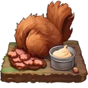
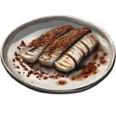

# Heist buffs

**Where to play:** Discord
{ .where-to-play }

Eat a buff from the heist menu's **Heist Buffs** (every buff of every game: [Buffs by game](../../../items/buffs.md)); each one you eat is one **charge**. **Every charge you hold that applies to your side is used on every heist you're in, one charge each**, whether it changed the outcome or not.

| Buff | Effect | Used when |
|---|---|---|
| [Wild Turkey with Cranberry Glaze](wild-turkey-with-cranberry-glaze.md) | +2 experience gained | attacking; also in your counter-attack |
| [Fried Squirrel with Sawmill Gravy](fried-squirrel-with-sawmill-gravy.md) | the defender loses 1 more | attacking; also in your counter-attack |
| [Grilled Eel with Sichuan Peppercorns](grilled-eel-with-sichuan-peppercorns.md) | 5% chance to keep the energy | attacking |
| [Moose with Blueberry Sauce](moose-with-blueberry-sauce.md) | 10% chance to block | defending; attacking, only when you're counter-attacked |
| [Seared Tuna with Wasabi Butter](seared-tuna-with-wasabi-butter.md) | 3% chance to counter-attack | defending |
| [Mackerel and Smoked Paprika](mackerel-and-smoked-paprika.md) | 1 less experience lost | defending; attacking, only when you're counter-attacked |
| [Einherjar's Barrier Draught](einherjars-barrier-draught.md) (super buff) | 100% block | defending; attacking, only when you're counter-attacked |
| [Skadi's Retribution Brew](skadis-retribution-brew.md) (super buff) | 100% counter-attack | defending |
| [Frigg's Resurgence Elixir](friggs-resurgence-elixir.md) (super buff) | 100% chance to keep the energy | attacking |
| [Retribution Fury](retribution-fury.md) (earned) | 100% counter-attack | defending |
| [Assault Fortification](assault-fortification.md) (earned) | 100% block | defending; attacking, only when you're counter-attacked |

- A buff used "only when you're counter-attacked" (Moose, Mackerel, Barrier Draught, Assault Fortification) stays when you attack and nobody strikes back. A defending-only buff (Seared Tuna, Retribution Brew, Retribution Fury) stays when you attack, and an attacking-only one (Grilled Eel, Frigg's Elixir) when you defend; Wild Turkey and Fried Squirrel wait for your attack or your counter-attack.
- **A deflected heist** uses none of the defender's charges (they weren't hit); the raider's are used once, on the heist that lands, with the new defender's.
- **Super buffs:** at most **5** a month. You must be on this month's heist ladder: you are once you joined, attacked or were attacked this month (in the heist since an earlier month, you're refused until then, and nothing is taken). For a clan member, the clan must be on this month's clan ladder too (opening the heist menu puts it there); both count them. A 6th is refused and nothing is taken.
- **Super buff charges you haven't used are gone at the month change:** the new month's first run resets them to 0. Your other buffs stay.
- **Earned buffs** come from the [attack types](../attacks-and-defence/index.md#one-heist), and from gear and pets that add a chance to earn them: each win adds one charge.

| Buff | Where it comes from |
|---|---|
| { .gi .gi-inline width="24" height="24" loading="lazy" } [Wild Turkey with Cranberry Glaze](wild-turkey-with-cranberry-glaze.md) | cooked: 2 [Wild Turkey](../../../items/ingredients.md#wild-turkey) + 2 [Cranberry Glaze](../../../items/ingredients.md#cranberry-glaze) ([the dish](../../../items/dishes.md#wild-turkey-with-cranberry-glaze)) |
| { .gi .gi-inline width="24" height="24" loading="lazy" } [Fried Squirrel with Sawmill Gravy](fried-squirrel-with-sawmill-gravy.md) | cooked: 2 [Squirrel](../../../items/ingredients.md#squirrel) + 1 [Sawmill Gravy](../../../items/ingredients.md#sawmill-gravy) ([the dish](../../../items/dishes.md#fried-squirrel-with-sawmill-gravy)) |
| { .gi .gi-inline width="24" height="24" loading="lazy" } [Grilled Eel with Sichuan Peppercorns](grilled-eel-with-sichuan-peppercorns.md) | cooked: 2 [Eel](../../../items/ingredients.md#eel) + 4 [Sichuan Peppercorns](../../../items/ingredients.md#sichuan-peppercorns) ([the dish](../../../items/dishes.md#grilled-eel-with-sichuan-peppercorns)) |
| { .gi .gi-inline width="24" height="24" loading="lazy" } [Moose with Blueberry Sauce](moose-with-blueberry-sauce.md) | cooked: 2 [Moose](../../../items/ingredients.md#moose) + 2 [Blueberry Sauce](../../../items/ingredients.md#blueberry-sauce) ([the dish](../../../items/dishes.md#moose-with-blueberry-sauce)) |
| { .gi .gi-inline width="24" height="24" loading="lazy" } [Seared Tuna with Wasabi Butter](seared-tuna-with-wasabi-butter.md) | cooked: 2 [Tuna](../../../items/ingredients.md#tuna) + 6 [Wasabi](../../../items/ingredients.md#wasabi) ([the dish](../../../items/dishes.md#seared-tuna-with-wasabi-butter)) |
| { .gi .gi-inline width="24" height="24" loading="lazy" } [Mackerel and Smoked Paprika](mackerel-and-smoked-paprika.md) | cooked: 2 [Mackerel](../../../items/ingredients.md#mackerel) + 4 [Smoked Paprika](../../../items/ingredients.md#smoked-paprika) ([the dish](../../../items/dishes.md#mackerel-and-smoked-paprika)) |
| { .gi .gi-inline width="24" height="24" loading="lazy" } [Einherjar's Barrier Draught](einherjars-barrier-draught.md) | 850 credits in the store (a super buff; [the item](../../../items/store-consumables.md#einherjars-barrier-draught)) |
| { .gi .gi-inline width="24" height="24" loading="lazy" } [Skadi's Retribution Brew](skadis-retribution-brew.md) | 850 credits in the store (a super buff; [the item](../../../items/store-consumables.md#skadis-retribution-brew)) |
| { .gi .gi-inline width="24" height="24" loading="lazy" } [Frigg's Resurgence Elixir](friggs-resurgence-elixir.md) | 850 credits in the store (a super buff; [the item](../../../items/store-consumables.md#friggs-resurgence-elixir)) |

