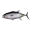

# { .gi .gi-title width="64" height="64" loading="lazy" } Seared Tuna with Wasabi Butter

**Where to play:** Discord
{ .where-to-play }

- **Kind:** a dish you eat
- **Each charge:** +3% Counter-Attack Chance
- **Used:** when you defend; the counter-attack takes 10 back

## Where you get it

Cooked at the [cooking table](../../cooking.md#the-fire-and-cooking) from 2 { .gi .gi-mention width="20" height="20" loading="lazy" }&nbsp;[Tuna](../../../items/ingredients.md#tuna) + 6 { .gi .gi-mention width="20" height="20" loading="lazy" }&nbsp;[Wasabi](../../../items/ingredients.md#wasabi); swapped for at the [convert market](../../../account/gifts-and-convert-market.md#the-convert-market); a prize of [Loot Reels](../../loot-reels.md). Everything about the item: { .gi .gi-mention width="20" height="20" loading="lazy" }&nbsp;[Seared Tuna with Wasabi Butter](../../../items/dishes.md#seared-tuna-with-wasabi-butter).

## Checked in play

- Exactly 3% to counter-attack: you win back 10 and the raider loses 10. Held while you attack, it stays.
- The heist menu lists it with its charges and its number and adds it to your stats; the log shows it among your triggered buffs when it's used.

## How buffs work

Each one you eat (or earn) is one charge. Every charge you hold that applies to your side is used on every heist you're in, one charge each, whether it changed the outcome or not; no charge goes below 0. More: [heist buffs](index.md).
