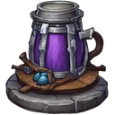

# { .gi .gi-title width="64" height="64" loading="lazy" } Skadi's Retribution Brew

**Where to play:** Discord
{ .where-to-play }

- **Kind:** a super buff (at most 5 a month)
- **Each charge:** +100% Counter-Attack Chance
- **Used:** when you defend: the next hit is counter-attacked

## Where you get it

Bought in the 🏪&nbsp;[store](../../../account/store.md); a prize of 🎰&nbsp;[Loot Reels](../../loot-reels.md). Everything about the item: { .gi .gi-mention width="20" height="20" loading="lazy" }&nbsp;[Skadi's Retribution Brew](../../../items/consumables/store-consumables.md#skadis-retribution-brew).

## Checked in play

- Counter-attacks the next hit: the raider loses what you win back. Held while you attack, it stays.
- The heist menu lists it with its charges and its number and adds it to your stats; the log shows it among your triggered buffs when it's used.

## How buffs work

Each one you eat (or earn) is one charge. Every charge you hold that applies to your side is used on every heist you're in, one charge each, whether it changed the outcome or not; no charge goes below 0. More: 💪&nbsp;[heist buffs](index.md).
