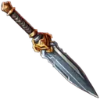
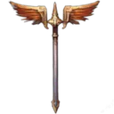
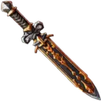

# { .gi .gi-title width="64" height="64" loading="lazy" } Odin's Furyblade

**Where to play:** Discord
{ .where-to-play }

- **Slot:** weapon
- **When attacking:** Increased Exp Gain +1
- **When defending:** –
- **Crafting cost:** 225 { .gi .gi-mention width="20" height="20" loading="lazy" }&nbsp;[Wood Scrap](../../../items/materials/scrap.md#wood-scrap), 275 { .gi .gi-mention width="20" height="20" loading="lazy" }&nbsp;[Metal Scrap](../../../items/materials/scrap.md#metal-scrap), 100 { .gi .gi-mention width="20" height="20" loading="lazy" }&nbsp;[Leather Scrap](../../../items/materials/scrap.md#leather-scrap)

## Checked in play

- You steal 12 instead of 11 with the +1 attack, and when you defend and counter-attack you win back 11 instead of 10.
- Its numbers are the ones on the gear screen, the crafting screen and the heist menu (Heist - Modifiers and Heist - Stats). Worn on the other side of a heist, or taken off, it does nothing; every slot adds up.

## How gear works

You craft it with scrap from the heist gear menu (exactly the scrap listed) and wear one item per slot. An attacking bonus works when you attack, a defending bonus when you defend. A counter-attack is the defender's attack and the raider's defence for experience: an attacking experience bonus also adds to your counter-attack when you defend, and a defending block or experience bonus also protects you when you're counter-attacked as the raider; a counter-attack never gives energy back or earns a buff. Without Tactical Shift your neutral set counts both ways; with it, the offensive set attacks and the defensive set defends, and in a counter-attack each side keeps the set it's wearing (the raider their offensive set, the defender their defensive set). Every slot adds up. More: [heist gear](index.md).

Other items for the weapon slot: { .gi .gi-mention width="20" height="20" loading="lazy" }&nbsp;[Freyja's Enchanting Whisper](freyjas-enchanting-whisper.md), { .gi .gi-mention width="20" height="20" loading="lazy" }&nbsp;[Valkyrie's Vengeance](valkyries-vengeance.md), { .gi .gi-mention width="20" height="20" loading="lazy" }&nbsp;[Forseti's Judgment](forsetis-judgment.md).
