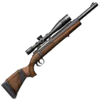

# Hunting

**Where to play:** Discord
{ .where-to-play }

An idle activity: you spend energy, wait while your trip runs, and come back to a catch. Hunting fills your basket with meat for [cooking](cooking.md). [Fishing](fishing.md) and [expeditions](expeditions.md) work the same way.

**Where:** `/hunt` goes on a one-energy trip straight away. `/start` → **Activities** → **Hunt** lets you pick how much energy to spend, and holds the crafting, equipment and buff menus.

## How a trip works

1. You choose how much energy to spend. Each energy is **10 seconds** of trip.
2. While the trip runs you're busy: you can't start another hunt, fishing trip or expedition until it's over (the bot tells you, privately, that you're already busy and until when).
3. Every second of the trip is one roll for a catch, and one roll on the trip's extra prizes (scrap, pet items, tokens and more; the table is at the end of this page).
4. At the end you get your catch, your experience and your quest progress, and the trip counts on the leaderboards.

A trip pays exactly once. Clicking twice, or using two devices, starts one trip and spends the energy once. If the bot restarts during your trip, the trip is finished when the bot is back, and paid once.

## Energy

| Activity | Energy each day | Most energy | Seconds per energy |
|---|---|---|---|
| Hunting | 10 + Hunting Cabin level | 22 (level 12, rank 96) | 10 (+2 per Hunting Weed) |

- Energy refills at **00:00 UTC** every day. The refill sets your energy to the day's full amount; it doesn't add to what you had left.
- A trip that runs over midnight still pays once.
- **Out of hunting energy?** A **[Wild Boar with Cherry Sauce](../items/dishes.md#wild-boar-with-cherry-sauce)** pays for one more energy of hunting. It's only used for the energy your daily energy doesn't cover, never while you still have energy. Without one, the trip doesn't start and nothing is spent: `/hunt` tells you so privately, with your hunting menu (your energy, when it refills), and a **Go Hunting** button on a menu from earlier tells you privately and leaves the menu as it was.

## Experience, quests and leaderboards

A hunt pays **1 experience per energy**.

Trips also move your [quests](../account/quests.md#every-quest): the Hunting quest counts the energy you spend, and the quest for each animal counts what you catch of it (Hunting - Elk counts your elk). A quest that reaches its goal completes on its own and pays its reward once.

The hunting leaderboards count the seconds of your trips (weed seconds included).

## Rifles

You craft them in the **Hunt** menu (**Craft Hunting Rifle**) for scrap from your pouch. You can own one of each. Without one, you only catch Squirrel.

| Item | Crafting cost (wood / metal / leather scrap) | Catches, chance each second |
|---|---|---|
| { .gi .gi-inline width="24" height="24" loading="lazy" } no rifle | – | [Squirrel](../items/ingredients.md#squirrel) 5% |
| { .gi .gi-inline width="24" height="24" loading="lazy" } Savage Model 11 | 1 / 6 / 2 | [Squirrel](../items/ingredients.md#squirrel) 5%, [Rabbit](../items/ingredients.md#rabbit) 5%, [Coyote](../items/ingredients.md#coyote) 5% |
| { .gi .gi-inline width="24" height="24" loading="lazy" } Winchester Model 70 | 16 / 41 / 20 | [Wild Turkey](../items/ingredients.md#wild-turkey) 5%, [Pheasant](../items/ingredients.md#pheasant) 5%, [White-tailed Deer](../items/ingredients.md#white-tailed-deer) 5% |
| { .gi .gi-inline width="24" height="24" loading="lazy" } Weatherby Mark V | 50 / 200 / 60 | [Elk](../items/ingredients.md#elk) 5%, [Moose](../items/ingredients.md#moose) 5%, [Wild Boar](../items/ingredients.md#wild-boar) 5% |

- Equip a rifle in the Hunt menu. **The one equipped when the trip ends decides the catch**, so a swap during a trip counts.
- With more than one rifle you can turn on **rotative** hunting: each second of the trip rolls on the next one in turn. With only one, the switch isn't offered and a trip never rotates.
- Crafting costs exactly the scrap shown. With a scrap short, or a rifle you already own, the Craft button is off.

### Enhancements

Each rifle has its own enhancement, upgraded from the crafting screen for scrap. Every level adds **0.1 percentage points** to each of that rifle's three catches (not to your other rifles). Each level needs a rank of twice the level (the crafting screen shows it as "User Level"): below it the upgrade button is off, and a click on an older one upgrades nothing and tells you, privately, the rank you need. The costs below are wood / metal / leather scrap.

| Item | Enhancement | Each level | Level 1 (rank 2) | Level 2 (rank 4) | Level 10 (rank 20) | Level 25 (rank 50) | Level 50 (rank 100) |
|---|---|---|---|---|---|---|---|
| { .gi .gi-inline width="24" height="24" loading="lazy" } Savage Model 11 | Phantomstrike Optics | +0.1 points on each of its catches | 1 / 5 / 3 | 2 / 7 / 5 | 9 / 27 / 18 | 21 / 63 / 42 | 41 / 123 / 82 |
| { .gi .gi-inline width="24" height="24" loading="lazy" } Winchester Model 70 | Precision Prowler | +0.1 points on each of its catches | 16 / 6 / 8 | 22 / 8 / 11 | 70 / 28 / 35 | 160 / 64 / 80 | 310 / 124 / 155 |
| { .gi .gi-inline width="24" height="24" loading="lazy" } Weatherby Mark V | Tempest Vision | +0.1 points on each of its catches | 52 / 22 / 15 | 70 / 30 / 20 | 210 / 90 / 60 | 472 / 202 / 135 | 910 / 390 / 260 |

## Utilities: Skinning Knife

Crafted for credits in `/start` → **Inventory** → **Utilities**. Every level adds **0.05 percentage points** to the chance of finding [Leather Scrap](../items/materials.md#leather-scrap): in hunting's extra prizes, on the Nature Expedition ([expeditions](expeditions.md)), and in the other prize tables that have [Leather Scrap](../items/materials.md#leather-scrap) (votes, bumps, chat, dice, heists, treasure chests and more). With exactly the price in your wallet you can craft it. **Level n needs rank n** (the screen shows it as "User Level"): below it the craft button is off, and a click on an older one crafts nothing and tells you, privately, the rank you need. The other two utilities, the Wood Axe and the Mining Pick, raise Wood and [Metal Scrap](../items/materials.md#metal-scrap) ([fishing](fishing.md)).

| Utility | Raises | Each level | Level 1 | Level 2 | Level 3 | Level 5 | Level 10 | Level 25 | Level 50 |
|---|---|---|---|---|---|---|---|---|---|
| { .gi .gi-inline width="24" height="24" loading="lazy" } Skinning Knife | Leather Scrap | +0.05 points | 350 credits | 612 credits | 875 credits | 1,400 credits | 2,712 credits | 6,650 credits | 13,212 credits |

## Buffs

| Buff | Where it comes from | Used by |
|---|---|---|
| { .gi .gi-inline width="24" height="24" loading="lazy" } [Hunting Weed](../items/store-consumables.md#hunting-weed) | 3 credits in the store; the Party Store | hunting |
| { .gi .gi-inline width="24" height="24" loading="lazy" } [Wild Boar with Cherry Sauce](../items/dishes.md#wild-boar-with-cherry-sauce) | cooked: 2 [Wild Boar](../items/ingredients.md#wild-boar) + 6 [Cherry Sauce](../items/ingredients.md#cherry-sauce) | hunting, when the energy is gone |

- **[Hunting Weed](../items/store-consumables.md#hunting-weed)** (bought from the store, or collected at the Party Store): each one adds **2 seconds** to one energy of a trip, so a trip uses **one per energy**, at most. A 3-energy trip with 2 weeds lasts 34 seconds. The extra seconds roll for catches and extra prizes like any other second, and count on the leaderboard. Experience and the Hunting quest count energy, so the extra seconds add none.
- The hunting menu shows the buffs you have and the trip time they give.

## Pets

Your active pet helps while it's **awake** and cared for (see [Pets](../account/pets.md) for every pet, its perks and when they work). Its hunting perk adds its points to one animal. Asleep, or below the perk's conditions, the pet adds nothing.

## Buildings that help

In [Buildings](../account/buildings.md): the **[Hunting Cabin](../account/buildings.md#what-each-building-does)** gives +1 hunting energy a day per level.

Everything adds up once: a rifle enhancement, a pet perk, weed and the Hunting Cabin on one trip each count exactly once.

## Extra prizes, every second

Without utilities, pets or buildings. Each second rolls once on this table (at most one prize a second).

| Prize | Chance each second |
|---|---|
| { .gi .gi-inline width="24" height="24" loading="lazy" } 1 [Leather Scrap](../items/materials.md#leather-scrap) | 0.3% |
| { .gi .gi-inline width="24" height="24" loading="lazy" } 6 [Chaos Relic](../items/keys-and-cards.md#chaos-relic) | 0.15% |
| { .gi .gi-inline width="24" height="24" loading="lazy" } 1 [Common Pet Token](../items/pet-items.md#common-pet-token) | 0.5% |
| 1 [Pet Token](../items/pet-items.md#pet-tokens) (Uncommon, Rare, Epic, Legendary, Mythical) | 0.25% each |
| 1 [Pet Food](../items/pet-items.md#pet-food) (Common, Uncommon, Rare, Epic, Legendary, Mythical) | 0.5% each |
| 1 [Pet Cure](../items/pet-items.md#pet-cures) (Common, Uncommon, Rare, Epic, Legendary, Mythical) | 0.5% each |
| 1 [Pet Wash Kit](../items/pet-items.md#pet-wash-kits) (Common, Uncommon, Rare, Epic, Legendary, Mythical) | 0.5% each |
| nothing | 88.8% |

## Tips

- Spend the day's energy before 00:00 UTC: the refill doesn't carry leftovers over.
- A rifle's enhancement only helps its own three animals.
- Weed is used one per energy: a 10-energy trip uses 10.
