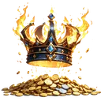
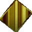

# 🎫 Games

Every game of Runebase World, each on its own page; each page says where you can play it. How they connect: [the guide's first page](../index.md#how-the-games-connect).

| Game | What it is |
|---|---|
| 👹&nbsp;[Hack & Slash](hack-and-slash/index.md) | the role-playing game: quick battles, the Jotnar world boss, the Arena, gear and the auction house |
| { .gi .gi-mention width="20" height="20" loading="lazy" }&nbsp;[Crown of Chaos](crown-of-chaos/index.md) | one player holds the Crown, everyone else attacks it with { .gi .gi-mention width="20" height="20" loading="lazy" }&nbsp;[Chaos Relics](../items/keys-and-cards/cards-and-relics.md#chaos-relic); a reign pays the Crown pool |
| { .gi .gi-mention width="20" height="20" loading="lazy" }&nbsp;[Heists and clans](heists-and-clans/index.md) | steal experience from other players, join a clan, climb the monthly ladder |
| { .gi .gi-mention width="20" height="20" loading="lazy" }&nbsp;[Fishing](fishing.md) | trips on energy that catch fish, with rods to craft and enhance |
| 🏹&nbsp;[Hunting](hunting.md) | trips on energy that catch meat, with rifles to craft and enhance |
| 🧭&nbsp;[Expeditions](expeditions.md) | trips on energy that bring back scrap, crafting materials and credits |
| { .gi .gi-mention width="20" height="20" loading="lazy" }&nbsp;[Cooking](cooking.md) | the fire and the cooking table: fish and meat become dishes that buff the other games |
| 🎰&nbsp;[Loot Reels](loot-reels.md) | free spins every day |
| 🔤&nbsp;[WordWeaver](wordweaver.md) | guess a hidden word in six tries |
| ♟️&nbsp;[Chess](chess.md) | chess against the bot or another player |
| 🏰&nbsp;[Hnefatafl](hnefatafl.md) | the Viking board game, against the bot or ranked against other players |
| { .gi .gi-mention width="20" height="20" loading="lazy" }&nbsp;[Dice](dice.md) | `/roll` two dice for experience, a RUNES prize and a prize draw |
| { .gi .gi-mention width="20" height="20" loading="lazy" }&nbsp;[Treasure chests](treasure-chests.md) | open a chest with a { .gi .gi-mention width="20" height="20" loading="lazy" }&nbsp;[Bronze](../items/keys-and-cards/treasure-keys.md#bronze-key), { .gi .gi-mention width="20" height="20" loading="lazy" }&nbsp;[Silver](../items/keys-and-cards/treasure-keys.md#silver-key) or { .gi .gi-mention width="20" height="20" loading="lazy" }&nbsp;[Gold Key](../items/keys-and-cards/treasure-keys.md#gold-key) |
| 🗝️&nbsp;[Piles and the key hunt](piles-and-key-hunt.md) | grab the piles that appear in the channels; the keys you find score on a monthly ladder |
| { .gi .gi-mention width="20" height="20" loading="lazy" }&nbsp;[Scratch cards](scratch-cards.md) | scratch a card with a { .gi .gi-mention width="20" height="20" loading="lazy" }&nbsp;[Mystery Card](../items/keys-and-cards/cards-and-relics.md#mystery-card) for RUNES, experience, keys and more |
| 🃏&nbsp;[Runes Pattern](runes-pattern.md) | the whole server's game: mark the words on your card as they appear in the channel |
