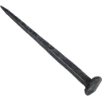
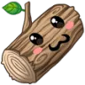
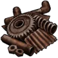
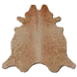
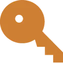
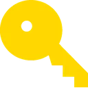
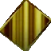

# 🗝️ Piles and the key hunt

**Where to play:** Discord
{ .where-to-play }

Be first to grab the piles that appear in the server's channels, and climb the monthly key hunt with the treasure keys you find. Keys open { .gi .gi-mention width="20" height="20" loading="lazy" }&nbsp;[treasure chests](treasure-chests.md).

## Piles

Piles of credits, treasure keys, scrap and building supplies appear in the server's channels for a short time, in every 🌍&nbsp;[realm](../account/realms.md): each server gets every kind of pile on the same schedule, in channels its verified members can see. What you collect goes to your account in that server (its pouch, its quests and boards, its key hunt and its 4-hour key windows). To collect one, press its button and answer the **captcha**: the first players to answer correctly take the pile's slots. A pile is collected only in the server it appeared in: its button pressed anywhere else is refused privately, and nothing is collected.

- **Credit piles** are shared: each collector gets their share and **2 experience**. Answering the captcha wrong, or collecting twice, pays nothing. The pile's post says what it holds, each share and how many shares are left, to the last 0.00000001 credits, and after each collect it shows what's left and who collected (until 2026-11-04 it kept showing the whole pile as left); your collect posts your share.
- A wrong answer shows the captcha again, marked incorrect, with the tries you have left: press **Answer** again for another try.
- **Three tries per pile:** after your third wrong answer on a pile you can't collect that pile any more. The captcha says so (it closes, with no picture and no **Answer** button), and so does the pile's button if you press it again. Every kind of pile counts this way (credits, treasure keys, scrap, building supplies), and every player has their own three tries: your wrong answers don't count against anyone else. The count lasts until the pile ends, a restart of the bot included.
- Discord shows you one captcha at a time: a captcha you closed without answering doesn't count, and your next answer goes to the pile you answered, once.
- **One captcha per pile:** pressing a pile's button again gives you a fresh captcha and removes the one you had, so you never have a pile of captchas for one pile.
- **A pile that fills or ends while your captcha is open:** your captcha says so ("This credits pile has been fully collected.", or "… has expired."), with no picture and no **Answer** button; it no longer just disappears. You get one such note per pile, however often you pressed its button. An older captcha whose **Answer** button still shows (after a restart of the bot, for instance) tells you privately that it's closed: press the pile's button again for a new captcha if the pile is still there.
- A pile still open when the bot restarts stays collectable until its time is up.
- A pile has a limited number of slots: when more players answer than there are slots, only the first ones are paid, and the others are told.
- **An answer in a pile's last moment** that the bot gets to only after the pile's time is up is told "You're out of time!": nothing is collected, and it doesn't count as one of your three tries.
- **An answer that reaches no captcha:** if you open the answer box in a pile's last seconds and send it after the pile's end, or the bot restarts while the box is open, only you are told "This captcha is closed. If the pile is still there, press its button for a new one." Nothing is checked or collected.
- **A pile's button after the pile ended** (its post still up) says the pile has expired; nothing is collected.
- **Banned from the bot:** an answer to a captcha you opened before the ban collects nothing; your captcha says "You can't collect this …: your account is banned from the bot." (it doesn't count as one of your three tries).
- Your captcha works for as long as its pile is open (a credit or supply pile stays 25 minutes), however long ago you pressed the pile's button.
- **Two devices:** if you answer on one device a captcha you replaced by pressing the pile's button on another, that answer counts once, and answering the newer captcha then tells you you've already collected the pile.
- **A full pouch:** a key or scrap pile answered right while that part of your pouch is full tells you so on the captcha; nothing is collected, the slot stays for the others, and the answer doesn't count as one of your tries. Make room (or upgrade your pouch) and press the pile's button again while it's open.
- When a credit pile expires, its unclaimed share goes to the **Crown of Chaos** pool, also a pile that spilled from that pool: what nobody claimed goes back into it.
- A key or scrap pile's post says after each collect how many are left and who collected; a supply pile's says how many Nails or Ropes are left.
- A key or supply pile taken to its last slot is replaced by a post naming who collected it, with a **Pouch** (keys, scrap) or **Basket** (building supplies) button: whoever clicks it sees their own pouch or basket, privately; the post stays as it is.
- **Nail piles** come every hour: each of their players gets the same number of { .gi .gi-mention width="20" height="20" loading="lazy" }&nbsp;[Nails](../items/materials/building-supplies.md#nail) (3 to 9, set when the pile appears) and 2 experience. A Rope pile works the same way with { .gi .gi-mention width="20" height="20" loading="lazy" }&nbsp;[Rope](../items/materials/building-supplies.md#rope). The pile's post says how many each player gets, the total and how many are left.
- **Scrap piles**: each collector gets one 🔩&nbsp;[scrap](../items/materials/scrap.md) of the pile's kind ({ .gi .gi-mention width="20" height="20" loading="lazy" }&nbsp;[Wood Scrap](../items/materials/scrap.md#wood-scrap), { .gi .gi-mention width="20" height="20" loading="lazy" }&nbsp;[Metal Scrap](../items/materials/scrap.md#metal-scrap) or { .gi .gi-mention width="20" height="20" loading="lazy" }&nbsp;[Leather Scrap](../items/materials/scrap.md#leather-scrap)) and 1 experience (the post's number of scraps is one for each of its slots).
- In a server without an experience channel, where collects are posted, a collect pays all the same and shows what you got on your own screen, where you answered the captcha, also when you took the pile's last spot.
- **A pile's post deleted while you collect** (by the server's staff, or by the pile's last collect at the same moment): you get your share all the same, and a credit pile's unclaimed slots still go to the Crown's pool at its end.
- **What your collect posts is what you got:** the summary's first lines are the pile's own loot (the scrap, the Nails or Rope, the experience), exactly what went into your pouch or basket; a quest the collect completes lists its rewards under its own heading.
- **Treasure keys**: the first key of each type you find in **4 hours** pays **10 experience**. Within those 4 hours, your **6th { .gi .gi-mention width="20" height="20" loading="lazy" }&nbsp;[Bronze Key](../items/keys-and-cards/treasure-keys.md#bronze-key), 4th { .gi .gi-mention width="20" height="20" loading="lazy" }&nbsp;[Silver Key](../items/keys-and-cards/treasure-keys.md#silver-key) or 2nd { .gi .gi-mention width="20" height="20" loading="lazy" }&nbsp;[Gold Key](../items/keys-and-cards/treasure-keys.md#gold-key)** also gives a { .gi .gi-mention width="20" height="20" loading="lazy" }&nbsp;[Mystery Card](../items/keys-and-cards/cards-and-relics.md#mystery-card). Each type counts on its own, and its 4 hours start with its first key; the message for each key you find says when they end and how many more you need for the card. A restart of the bot, even in the middle of your find, never pays those 10 experience twice and never loses them.

When they come, how long they stay and what they hold:

| Pile | Scheduled | Appears | Open for | Players | Each player gets |
|---|---|---|---|---|---|
| Bronze Key | every 15 minutes | a random moment up to 15 minutes later | 3 minutes | 2 | 1 { .gi .gi-mention width="20" height="20" loading="lazy" }&nbsp;[Bronze Key](../items/keys-and-cards/treasure-keys.md#bronze-key) |
| Silver Key | every 30 minutes | a random moment up to 30 minutes later | 3 minutes | 2 | 1 { .gi .gi-mention width="20" height="20" loading="lazy" }&nbsp;[Silver Key](../items/keys-and-cards/treasure-keys.md#silver-key) |
| Gold Key | every hour | a random moment up to 1 hour later | 3 minutes | 2 | 1 { .gi .gi-mention width="20" height="20" loading="lazy" }&nbsp;[Gold Key](../items/keys-and-cards/treasure-keys.md#gold-key) |
| Scrap (wood, metal or leather) | every hour | a random moment up to 1 hour later | 10 minutes | 4 to 8 | 1 scrap of the pile's kind |
| Rope | at 00:00, 08:00 and 16:00 UTC | a random moment up to 8 hours later | 25 minutes | 4 to 10 | 1 to 3 { .gi .gi-mention width="20" height="20" loading="lazy" }&nbsp;[Ropes](../items/materials/building-supplies.md#rope) (the same for every player of the pile) |
| Nail | every hour | a random moment up to 2 hours later | 25 minutes | 4 to 10 | 3 to 9 { .gi .gi-mention width="20" height="20" loading="lazy" }&nbsp;[Nails](../items/materials/building-supplies.md#nail) (the same for every player of the pile) |
| Credits | every hour | a random moment up to 1 hour later | 25 minutes | 3 to 6 | an equal share of 100 to 200 credits |

**Pile boards** (`/leaderboard`): the Scrap, Credits Pile and BuildingSupply Pile Collector boards, all-time and monthly, count **1 for each pile you collect**, whatever it held. The TreasureKey Finder board counts 1 for each key.

## Key hunt

The **Monthly TreasureKey Hunt Ladder** (`/leaderboard`, monthly boards) ranks the treasure key hunters of the calendar month, each server its own (a key found in a server counts toward that server's ladder): each key you find scores **1 point for a { .gi .gi-mention width="20" height="20" loading="lazy" }&nbsp;[Bronze Key](../items/keys-and-cards/treasure-keys.md#bronze-key), 2 for a { .gi .gi-mention width="20" height="20" loading="lazy" }&nbsp;[Silver Key](../items/keys-and-cards/treasure-keys.md#silver-key), 3 for a { .gi .gi-mention width="20" height="20" loading="lazy" }&nbsp;[Gold Key](../items/keys-and-cards/treasure-keys.md#gold-key)**. When the staff pay the monthly prizes (on the Runebase server), last month's best hunters share **0.75% of the realm's RUNES wallet** by rank:

| Rank | Shares of the pool, each |
|---|---|
| 1 | 12 |
| 2 | 10 |
| 3 | 8 |
| 4 to 5 | 5 |
| 6 to 10 | 3 |
| 11 to 25 | 1.5 |
| 26 to 50 | 0.75 |

A tie goes to whoever found their keys first, and players who left the server or are banned from the bot are left out (of the ladder, its prizes and the winners role). Each server's winners are announced in that server's own experience channel. On the 1st, last month's winners get the Key Hunt Winner role: a winner who already has it keeps it and is told it's **extended**, and a former winner who didn't win again loses it.

## Tips

- Piles go fast: answer the captcha quickly.
