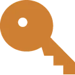

# 🗝️ Piles and the key hunt

**Where to play:** Discord
{ .where-to-play }

Be first to grab the piles that appear in the server's channels, and climb the monthly key hunt with the treasure keys you find. Keys open { .gi .gi-mention width="20" height="20" loading="lazy" }&nbsp;[treasure chests](treasure-chests.md).

## Piles

Piles of credits, treasure keys, scrap and building supplies appear in the server's channels for a short time, in every 🌍&nbsp;[realm](../account/realms.md): each server gets every kind of pile on the same schedule, in channels its verified members can see. What you collect goes to your account in that server (its pouch, its quests and boards, its key hunt and its 4-hour key windows). To collect one, press its button and answer the **captcha**: the first players to answer correctly take the pile's slots.

- **Credit piles** are shared: each collector gets their share. Answering the captcha wrong, or collecting twice, pays nothing.
- A wrong answer shows the captcha again, marked incorrect: press **Answer** again for another try.
- Discord shows you one captcha at a time: a captcha you closed without answering doesn't count, and your next answer goes to the pile you answered, once.
- A pile still open when the bot restarts stays collectable until its time is up.
- A pile has a limited number of slots: when more players answer than there are slots, only the first ones are paid, and the others are told.
- When a credit pile expires, its unclaimed share goes to the **Crown of Chaos** pool.
- A key or supply pile taken to its last slot is replaced by a post naming who collected it, with a **Pouch** (keys, scrap) or **Basket** (building supplies) button: whoever clicks it sees their own pouch or basket, privately; the post stays as it is.
- **Nail piles** come every hour: each of their players gets the same number of { .gi .gi-mention width="20" height="20" loading="lazy" }&nbsp;[Nails](../items/materials/building-supplies.md#nail) (3 to 9, set when the pile appears) and 2 experience.
- **Treasure keys**: the first key of each type you find in **4 hours** pays **10 experience**. Within those 4 hours, your **6th { .gi .gi-mention width="20" height="20" loading="lazy" }&nbsp;[Bronze Key](../items/keys-and-cards/treasure-keys.md#bronze-key), 4th { .gi .gi-mention width="20" height="20" loading="lazy" }&nbsp;[Silver Key](../items/keys-and-cards/treasure-keys.md#silver-key) or 2nd { .gi .gi-mention width="20" height="20" loading="lazy" }&nbsp;[Gold Key](../items/keys-and-cards/treasure-keys.md#gold-key)** also gives a { .gi .gi-mention width="20" height="20" loading="lazy" }&nbsp;[Mystery Card](../items/keys-and-cards/cards-and-relics.md#mystery-card). Each type counts on its own, and its 4 hours start with its first key; the message for each key you find says when they end and how many more you need for the card. A restart of the bot, even in the middle of your find, never pays those 10 experience twice and never loses them.

When they come, how long they stay and what they hold:

| Pile | Scheduled | Appears | Open for | Players | Each player gets |
|---|---|---|---|---|---|
| Bronze Key | every 15 minutes | a random moment up to 15 minutes later | 3 minutes | 2 | 1 { .gi .gi-mention width="20" height="20" loading="lazy" }&nbsp;[Bronze Key](../items/keys-and-cards/treasure-keys.md#bronze-key) |
| Silver Key | every 30 minutes | a random moment up to 30 minutes later | 3 minutes | 2 | 1 { .gi .gi-mention width="20" height="20" loading="lazy" }&nbsp;[Silver Key](../items/keys-and-cards/treasure-keys.md#silver-key) |
| Gold Key | every hour | a random moment up to 1 hour later | 3 minutes | 2 | 1 { .gi .gi-mention width="20" height="20" loading="lazy" }&nbsp;[Gold Key](../items/keys-and-cards/treasure-keys.md#gold-key) |
| Scrap (wood, metal or leather) | every hour | a random moment up to 1 hour later | 10 minutes | 4 to 8 | 1 scrap of the pile's kind |
| Rope | at 00:00, 08:00 and 16:00 UTC | a random moment up to 8 hours later | 25 minutes | 4 to 10 | 1 to 3 { .gi .gi-mention width="20" height="20" loading="lazy" }&nbsp;[Ropes](../items/materials/building-supplies.md#rope) (the same for every player of the pile) |
| Nail | every hour | a random moment up to 2 hours later | 25 minutes | 4 to 10 | 3 to 9 { .gi .gi-mention width="20" height="20" loading="lazy" }&nbsp;[Nails](../items/materials/building-supplies.md#nail) (the same for every player of the pile) |
| Credits | every hour | a random moment up to 1 hour later | 25 minutes | 3 to 6 | an equal share of 100 to 200 credits |

**Pile boards** (`/leaderboard`): the Scrap, Credits Pile and BuildingSupply Pile Collector boards, all-time and monthly, count **1 for each pile you collect**, whatever it held. The TreasureKey Finder board counts 1 for each key.

## Key hunt

The **Monthly TreasureKey Hunt Ladder** (`/leaderboard`, monthly boards) ranks the treasure key hunters of the calendar month, each server its own (a key found in a server counts toward that server's ladder): each key you find scores **1 point for a { .gi .gi-mention width="20" height="20" loading="lazy" }&nbsp;[Bronze Key](../items/keys-and-cards/treasure-keys.md#bronze-key), 2 for a { .gi .gi-mention width="20" height="20" loading="lazy" }&nbsp;[Silver Key](../items/keys-and-cards/treasure-keys.md#silver-key), 3 for a { .gi .gi-mention width="20" height="20" loading="lazy" }&nbsp;[Gold Key](../items/keys-and-cards/treasure-keys.md#gold-key)**. When the staff pay the monthly prizes (on the Runebase server), last month's best hunters share **0.75% of the realm's RUNES wallet** by rank:

| Rank | Shares of the pool, each |
|---|---|
| 1 | 12 |
| 2 | 10 |
| 3 | 8 |
| 4 to 5 | 5 |
| 6 to 10 | 3 |
| 11 to 25 | 1.5 |
| 26 to 50 | 0.75 |

A tie goes to whoever found their keys first, and players who left the server are left out.

## Tips

- Piles go fast: answer the captcha quickly.
