# The Runebase World Guide

**Runebase World** is the world of the Runebase games. Today you play it through the Runebase bot, in the Runebase Discord server and its partner servers ([realms](account/realms.md)); the Runebase World web app, with its MMORPG, comes later, and many games will be playable in both. Each game's page says where you can play it. The games are all connected: what you catch, find and build in one game helps you in the others, and almost everything pays **experience** (your rank) and **credits** (the bot's money, which you can withdraw as Credits tokens on the Runebase blockchain).

> **Coming soon:** this guide describes the bot's next update (v0.173.0). Until it's live, some rules and numbers on the bot are still the old ones.

**Start here:** chat in the server (your first message creates your account), then type `/start`. The main menu shows your rank card; **Activities** lists the games.

## What's in this guide

| Part | What you'll find |
|---|---|
| 🎫&nbsp;[Games](games/index.md) | every game, one by one: Hack & Slash, Crown of Chaos, heists, fishing, hunting, expeditions, cooking, the daily games, board games and prizes |
| 🎒&nbsp;[Items and buffs](items/index.md) | every dish, ingredient, material, key, card and pet item: where you get it and what it does in each game; every buff by game |
| 🎖️&nbsp;[Your account](account/index.md) | ranks, leaderboards and roles, credits and RUNES, buildings, pets, quests, the store, the basket, gifts, the convert market, the community rewards |
| 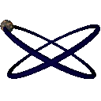{ .gi .gi-mention width="20" height="20" loading="lazy" }&nbsp;[The MMORPG](mmorpg/index.md) | the open-world game of the Runebase World web app, coming later |

## How the games connect

- **Every day at 00:00 UTC** your energy refills (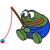{ .gi .gi-mention width="20" height="20" loading="lazy" }&nbsp;[fishing](games/fishing.md#energy), 🏹&nbsp;[hunting](games/hunting.md#energy), 🧭&nbsp;[expeditions](games/expeditions.md#energy); 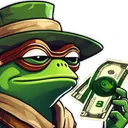{ .gi .gi-mention width="20" height="20" loading="lazy" }&nbsp;[heists](games/heists-and-clans/index.md#energy-and-hits): 3 energy, and you can be hit 6 times again), and the buildings' nightly production waits for you in **[Collect](account/buildings.md#collecting)**. Through the day: 15 🎰&nbsp;[Loot Reels](games/loot-reels.md) spins, a 🔤&nbsp;[WordWeaver](games/wordweaver.md) word every 4 hours, a single-player ♟️&nbsp;[chess](games/chess.md) game every 3 hours (5 paid wins a day) and ⚔️&nbsp;[Hnefatafl](games/hnefatafl.md) (5 paid wins a day), the 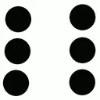{ .gi .gi-mention width="20" height="20" loading="lazy" }&nbsp;[dice](games/dice.md) on a cooldown, a 🗣️&nbsp;[chat payout](account/chat-points.md) every 12 hours, the ⛰️&nbsp;[bump](account/bumps.md) and 🗳️&nbsp;[vote](account/votes.md) windows. 🗝️&nbsp;[Piles and keys](games/piles-and-key-hunt.md) appear in the channels, and 🃏&nbsp;[Runes Pattern](games/runes-pattern.md) words keep coming.
- **Materials:** fishing, hunting and expeditions fill your basket and pouch (fish, meat, scrap). The fire and the 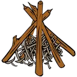{ .gi .gi-mention width="20" height="20" loading="lazy" }&nbsp;[cooking table](games/cooking.md) turn 🧺&nbsp;[fish, meat, spices and sauces](items/ingredients/index.md) into 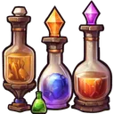{ .gi .gi-mention width="20" height="20" loading="lazy" }&nbsp;[dishes](items/consumables/index.md): 🍲&nbsp;[buffs](items/buffs.md) for the activities, the heists, Crown of Chaos and Hack & Slash. Scrap (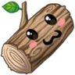{ .gi .gi-mention width="20" height="20" loading="lazy" }&nbsp;[wood](items/materials/scrap.md#wood-scrap), 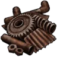{ .gi .gi-mention width="20" height="20" loading="lazy" }&nbsp;[metal](items/materials/scrap.md#metal-scrap), 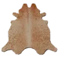{ .gi .gi-mention width="20" height="20" loading="lazy" }&nbsp;[leather](items/materials/scrap.md#leather-scrap)) from piles and activities pays for buildings, fire fuel and crafting; building supplies (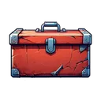{ .gi .gi-mention width="20" height="20" loading="lazy" }&nbsp;[Toolbox](items/materials/building-supplies.md#toolbox), 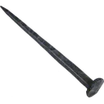{ .gi .gi-mention width="20" height="20" loading="lazy" }&nbsp;[Nail](items/materials/building-supplies.md#nail), 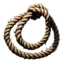{ .gi .gi-mention width="20" height="20" loading="lazy" }&nbsp;[Rope](items/materials/building-supplies.md#rope)) come from piles, prizes and the factories.
- **🏗️&nbsp;[Buildings](account/buildings.md)** (each level needs a rank) give lasting bonuses: more energy, longer expeditions, better store prices, stronger heists and battles, and nightly production.
- **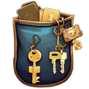{ .gi .gi-mention width="20" height="20" loading="lazy" }&nbsp;[Credits](account/credits-and-runes.md)** come from the games' prizes, quests, piles, chests and WordWeaver, chess and Hnefatafl wins, and from the 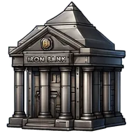{ .gi .gi-mention width="20" height="20" loading="lazy" }&nbsp;[Iron Bank](account/buildings.md#the-iron-bank)'s interest. You spend them in the store, on gifts, scratch cards, Runes Pattern cards and clan registration. Credits come in from RUNES (or Credits token) deposits and Hermes purchases, and go out as Credits tokens through withdrawals; some prizes (dice, chests, scratch cards, Crown of Chaos) pay 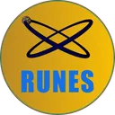{ .gi .gi-mention width="20" height="20" loading="lazy" }&nbsp;[RUNES](account/credits-and-runes.md#runes-prizes) directly.
- **Experience** comes from nearly everything and decides your **🥇&nbsp;[rank](account/ranks.md)**. Heists take experience from the defender and give experience to the attacker. Most games also have all-time and monthly **🏅&nbsp;[leaderboards](account/leaderboards.md)** with 🎭&nbsp;[roles](account/roles.md#top-roles) for the top players, and the heist and key hunt ladders can pay monthly RUNES prizes.
- **🐾&nbsp;[Pets](account/pets.md)** help in fishing, hunting, expeditions and heists while they're awake and cared for.

## What you can count on

- What a screen promises is what you're paid.
- A double click, or two devices at once, never pays twice or spends twice.
- If the bot restarts, nothing you earned is lost: trips, the nightly production and your games pick up where they were. While the bot is starting up, it answers "The bot is starting up…" and does nothing.
- When something is refused (not enough energy, credits or items), you get a clear message and nothing is spent.
- Refusals only you see, with the reason: a button or menu that isn't yours, a command used too often, the dice on cooldown, a chest without a key, a scratch card outside its channel, a refused collect or craft, the bot starting up, an old button, `/fish` and `/hunt` without energy (with your fishing or hunting menu) or while you're busy, an expedition you can't start (the expeditions menu stays as it was), `/fire` without wood or in a channel where fires can't burn, a `/gift` you can't make (the receiver doesn't see it), a store purchase or sale you can't make. What succeeds stays where it was: a trip, a fire, a gift and a store purchase still show in the channel.
- Buttons on old messages from an earlier version of the bot only show a note.
- **Commands have a limit** per 30 seconds. Past it the bot answers "Slow down!", only to you, and does nothing; once in 15 seconds: a command used again meanwhile isn't answered at all. 2 uses: `/info`, `/leaderboard`, `/poll`, `/price`, `/ranks`, `/withdraw`; 5: `/basket`, `/buildings`, `/convert`, `/craft`, `/equipment`, `/fire`, `/fish`, `/heist`, `/hunt`, `/loottables`, `/pouch`, `/quests`, `/rolepanel`, `/scratchcard`, `/settings`, `/start`, `/treasurechest`, and `/browseclans` and `/heistboard` together; 10: `/gift`, `/roll`; 20: `/hackslash`; 30: `/store`.

