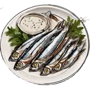
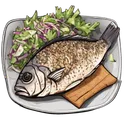
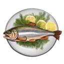

# { .gi .gi-title width="64" height="64" loading="lazy" } Consumables

What you eat or drink: the dishes cooked at the fire's { .gi .gi-mention width="20" height="20" loading="lazy" }&nbsp;[cooking table](../../games/cooking.md#the-fire-and-cooking) from 🧺&nbsp;[ingredients](../ingredients/index.md), and the drinks, brews and elixirs sold in the 🏪&nbsp;[store](../../account/store.md). Each entry says where you get it and what it does in the game it's for; 🍲&nbsp;[Buffs by game](../buffs.md) lists them by the game they help. Dishes wait in your **basket** (`/basket`), where { .gi .gi-mention width="20" height="20" loading="lazy" }&nbsp;[Swordfish Kebabs](fish-dishes.md#swordfish-kebabs-with-lemon-and-rosemary) are eaten for experience.

**{ .gi .gi-mention width="20" height="20" loading="lazy" }&nbsp;[Fish dishes](fish-dishes.md)**

<figure markdown="span">
[{ .gi .gi-gallery width="96" height="96" loading="lazy" }](fish-dishes.md#anchovy-with-anchovy-powder)
<figcaption>Anchovy with Anchovy Powder</figcaption>
</figure>

<figure markdown="span">
[{ .gi .gi-gallery width="96" height="96" loading="lazy" }](fish-dishes.md#mackerel-and-smoked-paprika)
<figcaption>Mackerel and Smoked Paprika</figcaption>
</figure>

<figure markdown="span">
[{ .gi .gi-gallery width="96" height="96" loading="lazy" }](fish-dishes.md#grilled-sardines-with-sumac-yogurt-sauce)
<figcaption>Grilled Sardines with Sumac Yogurt Sauce</figcaption>
</figure>

<figure markdown="span">
[{ .gi .gi-gallery width="96" height="96" loading="lazy" }](fish-dishes.md#baked-cod-with-old-bay-butter)
<figcaption>Baked Cod with Old Bay Butter</figcaption>
</figure>

<figure markdown="span">
[{ .gi .gi-gallery width="96" height="96" loading="lazy" }](fish-dishes.md#seared-tuna-with-wasabi-butter)
<figcaption>Seared Tuna with Wasabi Butter</figcaption>
</figure>

<figure markdown="span">
[{ .gi .gi-gallery width="96" height="96" loading="lazy" }](fish-dishes.md#blackened-tilapia-with-cumin-slaw)
<figcaption>Blackened Tilapia with Cumin Slaw</figcaption>
</figure>

<figure markdown="span">
[{ .gi .gi-gallery width="96" height="96" loading="lazy" }](fish-dishes.md#grilled-eel-with-sichuan-peppercorns)
<figcaption>Grilled Eel with Sichuan Peppercorns</figcaption>
</figure>

<figure markdown="span">
[{ .gi .gi-gallery width="96" height="96" loading="lazy" }](fish-dishes.md#pan-fried-trout-with-lemon-and-dill)
<figcaption>Pan-Fried Trout with Lemon and Dill</figcaption>
</figure>

<figure markdown="span">
[{ .gi .gi-gallery width="96" height="96" loading="lazy" }](fish-dishes.md#swordfish-kebabs-with-lemon-and-rosemary)
<figcaption>Swordfish Kebabs with Lemon and Rosemary</figcaption>
</figure>

**{ .gi .gi-mention width="20" height="20" loading="lazy" }&nbsp;[Meat dishes](meat-dishes.md)**

<figure markdown="span">
[{ .gi .gi-gallery width="96" height="96" loading="lazy" }](meat-dishes.md#fried-squirrel-with-sawmill-gravy)
<figcaption>Fried Squirrel with Sawmill Gravy</figcaption>
</figure>

<figure markdown="span">
[{ .gi .gi-gallery width="96" height="96" loading="lazy" }](meat-dishes.md#braised-rabbit-with-mustard-cream-sauce)
<figcaption>Braised Rabbit with Mustard Cream Sauce</figcaption>
</figure>

<figure markdown="span">
[{ .gi .gi-gallery width="96" height="96" loading="lazy" }](meat-dishes.md#grilled-coyote-steak-with-lingonberry-sauce)
<figcaption>Grilled Coyote Steak With Lingonberry Sauce</figcaption>
</figure>

<figure markdown="span">
[{ .gi .gi-gallery width="96" height="96" loading="lazy" }](meat-dishes.md#wild-turkey-with-cranberry-glaze)
<figcaption>Wild Turkey with Cranberry Glaze</figcaption>
</figure>

<figure markdown="span">
[{ .gi .gi-gallery width="96" height="96" loading="lazy" }](meat-dishes.md#pheasant-with-blackberry-balsamic-glaze)
<figcaption>Pheasant with Blackberry Balsamic Glaze</figcaption>
</figure>

<figure markdown="span">
[{ .gi .gi-gallery width="96" height="96" loading="lazy" }](meat-dishes.md#white-tailed-deer-with-juniper-berry-demi-glace)
<figcaption>White-tailed Deer with Juniper Berry Demi-Glace</figcaption>
</figure>

<figure markdown="span">
[{ .gi .gi-gallery width="96" height="96" loading="lazy" }](meat-dishes.md#elk-with-huckleberry-sauce)
<figcaption>Elk with Huckleberry Sauce</figcaption>
</figure>

<figure markdown="span">
[{ .gi .gi-gallery width="96" height="96" loading="lazy" }](meat-dishes.md#moose-with-blueberry-sauce)
<figcaption>Moose with Blueberry Sauce</figcaption>
</figure>

<figure markdown="span">
[{ .gi .gi-gallery width="96" height="96" loading="lazy" }](meat-dishes.md#wild-boar-with-cherry-sauce)
<figcaption>Wild Boar with Cherry Sauce</figcaption>
</figure>

**{ .gi .gi-mention width="20" height="20" loading="lazy" }&nbsp;[Store consumables](store-consumables.md)**

<figure markdown="span">
[{ .gi .gi-gallery width="96" height="96" loading="lazy" }](store-consumables.md#fishing-beer)
<figcaption>Fishing Beer</figcaption>
</figure>

<figure markdown="span">
[{ .gi .gi-gallery width="96" height="96" loading="lazy" }](store-consumables.md#hunting-weed)
<figcaption>Hunting Weed</figcaption>
</figure>

<figure markdown="span">
[{ .gi .gi-gallery width="96" height="96" loading="lazy" }](store-consumables.md#einherjars-barrier-draught)
<figcaption>Einherjar's Barrier Draught</figcaption>
</figure>

<figure markdown="span">
[{ .gi .gi-gallery width="96" height="96" loading="lazy" }](store-consumables.md#skadis-retribution-brew)
<figcaption>Skadi's Retribution Brew</figcaption>
</figure>

<figure markdown="span">
[{ .gi .gi-gallery width="96" height="96" loading="lazy" }](store-consumables.md#friggs-resurgence-elixir)
<figcaption>Frigg's Resurgence Elixir</figcaption>
</figure>

<figure markdown="span">
[{ .gi .gi-gallery width="96" height="96" loading="lazy" }](store-consumables.md#forgotten-throne-elixir)
<figcaption>Forgotten Throne Elixir</figcaption>
</figure>

