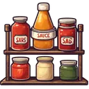
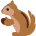
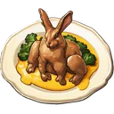
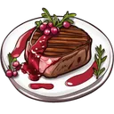
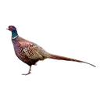
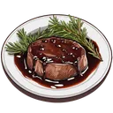
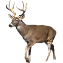
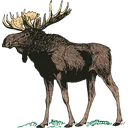
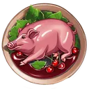

# { .gi .gi-title width="64" height="64" loading="lazy" } Meat dishes

Meat dishes are cooked at the fire's { .gi .gi-mention width="20" height="20" loading="lazy" }&nbsp;[cooking table](../../games/cooking.md#the-fire-and-cooking) from { .gi .gi-mention width="20" height="20" loading="lazy" }&nbsp;[meat](../ingredients/meat.md) and { .gi .gi-mention width="20" height="20" loading="lazy" }&nbsp;[sauces](../ingredients/sauces.md). Each entry says where you get the dish and what it does; 🍲&nbsp;[Buffs by game](../buffs.md) lists the buffs by the game they help.

## { .gi .gi-entry width="32" height="32" loading="lazy" } Fried Squirrel with Sawmill Gravy

> In the game: Increases opponent experience loss by 1 in the heist mini-game when attacking. Each Squirrel consumed strengthens your attacks, inflicting greater losses upon your adversaries.

- **Where you get it:** cooked at the { .gi .gi-mention width="20" height="20" loading="lazy" }&nbsp;[cooking table](../../games/cooking.md#the-fire-and-cooking) from 2 { .gi .gi-mention width="20" height="20" loading="lazy" }&nbsp;[Squirrel](../ingredients/meat.md#squirrel) + 1 { .gi .gi-mention width="20" height="20" loading="lazy" }&nbsp;[Sawmill Gravy](../ingredients/sauces.md#sawmill-gravy); swapped for at the ♻️&nbsp;[convert market](../../account/convert-market.md); a prize of 🎰&nbsp;[Loot Reels](../../games/loot-reels.md).
- **Heists:** the defender loses 1 more experience when you attack (and in your counter-attack) ([more](../../games/heists-and-clans/buffs/fried-squirrel-with-sawmill-gravy.md)).
- **Convert market:** can pay at the ♻️&nbsp;[convert market](../../account/convert-market.md), as a group 1 dish.

## { .gi .gi-entry width="32" height="32" loading="lazy" } Braised Rabbit with Mustard Cream Sauce

> In the game: Adds 2 seconds to an expedition for every energy it uses (one charge per energy).

- **Where you get it:** cooked at the { .gi .gi-mention width="20" height="20" loading="lazy" }&nbsp;[cooking table](../../games/cooking.md#the-fire-and-cooking) from 2 { .gi .gi-mention width="20" height="20" loading="lazy" }&nbsp;[Rabbit](../ingredients/meat.md#rabbit) + 2 { .gi .gi-mention width="20" height="20" loading="lazy" }&nbsp;[Mustard Cream Sauce](../ingredients/sauces.md#mustard-cream-sauce); swapped for at the ♻️&nbsp;[convert market](../../account/convert-market.md); a prize of 🎰&nbsp;[Loot Reels](../../games/loot-reels.md).
- **Expeditions:** +2 seconds per energy on an expedition, one charge per energy ([more](../../games/expeditions.md#buffs)).
- **Convert market:** can pay at the ♻️&nbsp;[convert market](../../account/convert-market.md), as a group 1 dish.

## { .gi .gi-entry width="32" height="32" loading="lazy" } Grilled Coyote Steak With Lingonberry Sauce

> In the game: Used in Hack'n'Slash RPG-Game for resetting stats

- **Where you get it:** cooked at the { .gi .gi-mention width="20" height="20" loading="lazy" }&nbsp;[cooking table](../../games/cooking.md#the-fire-and-cooking) from 2 { .gi .gi-mention width="20" height="20" loading="lazy" }&nbsp;[Coyote](../ingredients/meat.md#coyote) + 2 { .gi .gi-mention width="20" height="20" loading="lazy" }&nbsp;[Lingonberry Sauce](../ingredients/sauces.md#lingonberry-sauce); swapped for at the ♻️&nbsp;[convert market](../../account/convert-market.md); a prize of 🎰&nbsp;[Loot Reels](../../games/loot-reels.md).
- **Hack & Slash:** pays a stats reset (half a steak per point spent, rounded up) ([more](../../games/hack-and-slash/attributes-and-combat.md#attributes)).
- **Convert market:** can pay at the ♻️&nbsp;[convert market](../../account/convert-market.md), as a group 1 dish.

## { .gi .gi-entry width="32" height="32" loading="lazy" } Wild Turkey with Cranberry Glaze

> In the game: Increases experience gain by 2 in the heist mini-game when attacking. Each Turkey consumed enhances your attacks, enabling you to seize valuable experience points with unmatched efficiency.

- **Where you get it:** cooked at the { .gi .gi-mention width="20" height="20" loading="lazy" }&nbsp;[cooking table](../../games/cooking.md#the-fire-and-cooking) from 2 { .gi .gi-mention width="20" height="20" loading="lazy" }&nbsp;[Wild Turkey](../ingredients/meat.md#wild-turkey) + 2 { .gi .gi-mention width="20" height="20" loading="lazy" }&nbsp;[Cranberry Glaze](../ingredients/sauces.md#cranberry-glaze); swapped for at the ♻️&nbsp;[convert market](../../account/convert-market.md); a prize of 🎰&nbsp;[Loot Reels](../../games/loot-reels.md).
- **Heists:** +2 experience when you attack (and in your counter-attack) ([more](../../games/heists-and-clans/buffs/wild-turkey-with-cranberry-glaze.md)).
- **Convert market:** can pay at the ♻️&nbsp;[convert market](../../account/convert-market.md), as a group 2 dish.

## { .gi .gi-entry width="32" height="32" loading="lazy" } Pheasant with Blackberry Balsamic Glaze

> In the game: Restores the stamina of your class to full in the hack and slash game!

- **Where you get it:** cooked at the { .gi .gi-mention width="20" height="20" loading="lazy" }&nbsp;[cooking table](../../games/cooking.md#the-fire-and-cooking) from 2 { .gi .gi-mention width="20" height="20" loading="lazy" }&nbsp;[Pheasant](../ingredients/meat.md#pheasant) + 2 { .gi .gi-mention width="20" height="20" loading="lazy" }&nbsp;[Blackberry Balsamic Glaze](../ingredients/sauces.md#blackberry-balsamic-glaze); swapped for at the ♻️&nbsp;[convert market](../../account/convert-market.md); a prize of 🎰&nbsp;[Loot Reels](../../games/loot-reels.md).
- **Hack & Slash:** fills your stamina to its maximum (Restore Stamina now) ([more](../../games/hack-and-slash/quick-battles.md#quick-battles)).
- **Convert market:** can pay at the ♻️&nbsp;[convert market](../../account/convert-market.md), as a group 2 dish.

## { .gi .gi-entry width="32" height="32" loading="lazy" } White-tailed Deer with Juniper Berry Demi-Glace

> In the game: Adds 15-15 extra damage range to every Crown of Chaos attack you make (one charge per attack: a hit, a miss or a dodge)

- **Where you get it:** cooked at the { .gi .gi-mention width="20" height="20" loading="lazy" }&nbsp;[cooking table](../../games/cooking.md#the-fire-and-cooking) from 2 { .gi .gi-mention width="20" height="20" loading="lazy" }&nbsp;[White-tailed Deer](../ingredients/meat.md#white-tailed-deer) + 2 { .gi .gi-mention width="20" height="20" loading="lazy" }&nbsp;[Juniper Berry Demi-Glace](../ingredients/sauces.md#juniper-berry-demi-glace); swapped for at the ♻️&nbsp;[convert market](../../account/convert-market.md); a prize of 🎰&nbsp;[Loot Reels](../../games/loot-reels.md).
- **Crown of Chaos:** +15 damage on your attack on the Crown, one charge per attack ([more](../../games/crown-of-chaos/buffs.md)).
- **Convert market:** can pay at the ♻️&nbsp;[convert market](../../account/convert-market.md), as a group 2 dish.

## { .gi .gi-entry width="32" height="32" loading="lazy" } Elk with Huckleberry Sauce

> In the game: 100% Damage Bonus on your next Hack'n'Slash Rpg Battle!

- **Where you get it:** cooked at the { .gi .gi-mention width="20" height="20" loading="lazy" }&nbsp;[cooking table](../../games/cooking.md#the-fire-and-cooking) from 2 { .gi .gi-mention width="20" height="20" loading="lazy" }&nbsp;[Elk](../ingredients/meat.md#elk) + 2 { .gi .gi-mention width="20" height="20" loading="lazy" }&nbsp;[Huckleberry Sauce](../ingredients/sauces.md#huckleberry-sauce); swapped for at the ♻️&nbsp;[convert market](../../account/convert-market.md); a prize of 🎰&nbsp;[Loot Reels](../../games/loot-reels.md).
- **Hack & Slash:** double damage on a quick battle, picked before it or on the results screen and spent once ([more](../../games/hack-and-slash/quick-battles.md#quick-battles)).
- **Convert market:** can pay at the ♻️&nbsp;[convert market](../../account/convert-market.md), as a group 3 dish.

## { .gi .gi-entry width="32" height="32" loading="lazy" } Moose with Blueberry Sauce

> In the game: Enjoy a 10% chance to block an incoming hit in the heist mini-game when defending. Each Moose consumed fortifies your defenses, granting you the power to deflect enemy attacks and protect your precious resources.

- **Where you get it:** cooked at the { .gi .gi-mention width="20" height="20" loading="lazy" }&nbsp;[cooking table](../../games/cooking.md#the-fire-and-cooking) from 2 { .gi .gi-mention width="20" height="20" loading="lazy" }&nbsp;[Moose](../ingredients/meat.md#moose) + 2 { .gi .gi-mention width="20" height="20" loading="lazy" }&nbsp;[Blueberry Sauce](../ingredients/sauces.md#blueberry-sauce); swapped for at the ♻️&nbsp;[convert market](../../account/convert-market.md); a prize of 🎰&nbsp;[Loot Reels](../../games/loot-reels.md).
- **Heists:** 10% chance to block when you're hit; as the attacker, it blocks a counter-attack ([more](../../games/heists-and-clans/buffs/moose-with-blueberry-sauce.md)).
- **Convert market:** can pay at the ♻️&nbsp;[convert market](../../account/convert-market.md), as a group 3 dish.

## { .gi .gi-entry width="32" height="32" loading="lazy" } Wild Boar with Cherry Sauce

> In the game: Allow you to continue hunting when out of hunting energy

- **Where you get it:** cooked at the { .gi .gi-mention width="20" height="20" loading="lazy" }&nbsp;[cooking table](../../games/cooking.md#the-fire-and-cooking) from 2 { .gi .gi-mention width="20" height="20" loading="lazy" }&nbsp;[Wild Boar](../ingredients/meat.md#wild-boar) + 6 { .gi .gi-mention width="20" height="20" loading="lazy" }&nbsp;[Cherry Sauce](../ingredients/sauces.md#cherry-sauce); swapped for at the ♻️&nbsp;[convert market](../../account/convert-market.md); a prize of 🎰&nbsp;[Loot Reels](../../games/loot-reels.md).
- **Hunting:** one more energy of hunting when the day's energy is gone ([more](../../games/hunting.md#buffs)).
- **Convert market:** can pay at the ♻️&nbsp;[convert market](../../account/convert-market.md), as a group 3 dish.
