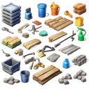

# { .gi .gi-title width="64" height="64" loading="lazy" } Materials

What builds and crafts: 🔩&nbsp;[scrap](scrap.md) and { .gi .gi-mention width="20" height="20" loading="lazy" }&nbsp;[building supplies](building-supplies.md) pay for [building and upgrading](../../account/buildings.md#building-and-upgrading) your buildings, scrap also crafts gear, and 🧵&nbsp;[Hack & Slash crafting materials](hack-and-slash-crafting-materials.md) [craft](../../games/hack-and-slash/gear-and-crafting.md#crafting) Hack & Slash items. Each entry says which. Scrap sits in your **pouch** (`/pouch`), which holds only so much: a store purchase that would overfill it is refused.

**🔩&nbsp;[Scrap](scrap.md)**

<figure markdown="span">
[{ .gi .gi-gallery width="96" height="96" loading="lazy" }](scrap.md#wood-scrap)
<figcaption>Wood Scrap</figcaption>
</figure>

<figure markdown="span">
[{ .gi .gi-gallery width="96" height="96" loading="lazy" }](scrap.md#leather-scrap)
<figcaption>Leather Scrap</figcaption>
</figure>

<figure markdown="span">
[{ .gi .gi-gallery width="96" height="96" loading="lazy" }](scrap.md#metal-scrap)
<figcaption>Metal Scrap</figcaption>
</figure>

**{ .gi .gi-mention width="20" height="20" loading="lazy" }&nbsp;[Building supplies](building-supplies.md)**

<figure markdown="span">
[{ .gi .gi-gallery width="96" height="96" loading="lazy" }](building-supplies.md#toolbox)
<figcaption>Toolbox</figcaption>
</figure>

<figure markdown="span">
[{ .gi .gi-gallery width="96" height="96" loading="lazy" }](building-supplies.md#nail)
<figcaption>Nail</figcaption>
</figure>

<figure markdown="span">
[{ .gi .gi-gallery width="96" height="96" loading="lazy" }](building-supplies.md#rope)
<figcaption>Rope</figcaption>
</figure>

**🧵&nbsp;[Hack & Slash crafting materials](hack-and-slash-crafting-materials.md)**

<figure markdown="span">
[{ .gi .gi-gallery width="96" height="96" loading="lazy" }](hack-and-slash-crafting-materials.md#standard-essence)
<figcaption>Standard Essence</figcaption>
</figure>

<figure markdown="span">
[{ .gi .gi-gallery width="96" height="96" loading="lazy" }](hack-and-slash-crafting-materials.md#elemental-core)
<figcaption>Elemental Core</figcaption>
</figure>

<figure markdown="span">
[{ .gi .gi-gallery width="96" height="96" loading="lazy" }](hack-and-slash-crafting-materials.md#primal-source)
<figcaption>Primal Source</figcaption>
</figure>

<figure markdown="span">
[{ .gi .gi-gallery width="96" height="96" loading="lazy" }](hack-and-slash-crafting-materials.md#basic-residue)
<figcaption>Basic Residue</figcaption>
</figure>

<figure markdown="span">
[{ .gi .gi-gallery width="96" height="96" loading="lazy" }](hack-and-slash-crafting-materials.md#enigmatic-nexus)
<figcaption>Enigmatic Nexus</figcaption>
</figure>

<figure markdown="span">
[{ .gi .gi-gallery width="96" height="96" loading="lazy" }](hack-and-slash-crafting-materials.md#mystical-node)
<figcaption>Mystical Node</figcaption>
</figure>

<figure markdown="span">
[{ .gi .gi-gallery width="96" height="96" loading="lazy" }](hack-and-slash-crafting-materials.md#elite-essence)
<figcaption>Elite Essence</figcaption>
</figure>

<figure markdown="span">
[{ .gi .gi-gallery width="96" height="96" loading="lazy" }](hack-and-slash-crafting-materials.md#radiant-shard)
<figcaption>Radiant Shard</figcaption>
</figure>

<figure markdown="span">
[{ .gi .gi-gallery width="96" height="96" loading="lazy" }](hack-and-slash-crafting-materials.md#shattered-prism)
<figcaption>Shattered Prism</figcaption>
</figure>

<figure markdown="span">
[{ .gi .gi-gallery width="96" height="96" loading="lazy" }](hack-and-slash-crafting-materials.md#engraving-tool)
<figcaption>Engraving Tool</figcaption>
</figure>

